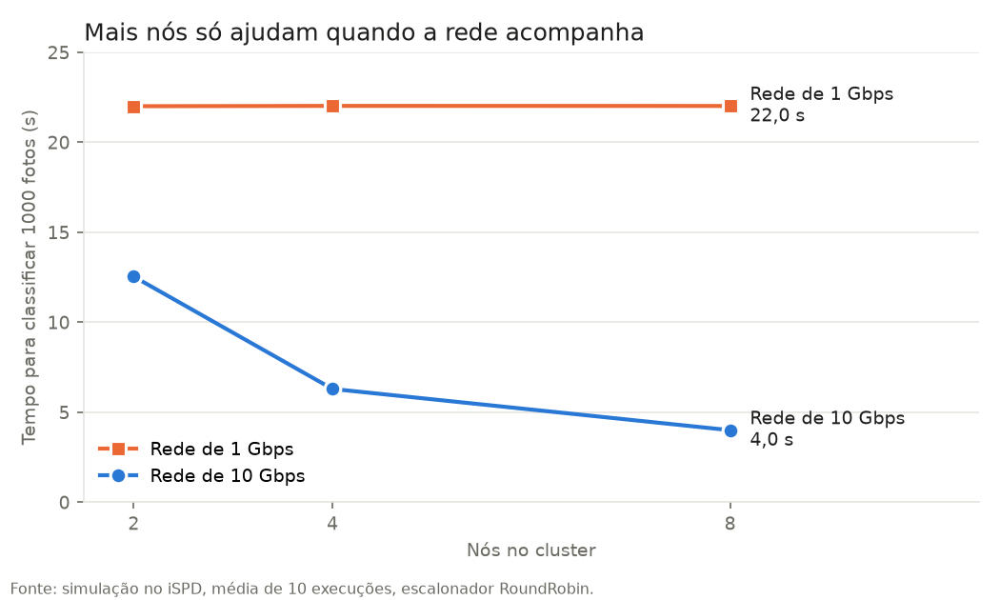
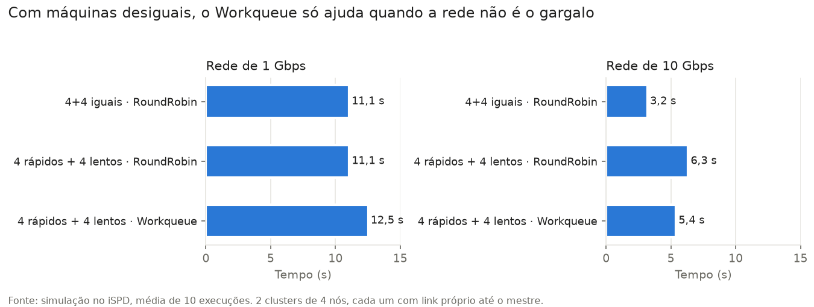

# Cluster Computing – simulação no iSPD

**Pergunta:** se o ZelaCidade receber 1000 fotos de uma vez (um pico na cidade inteira), como montar o
cluster que classifica essas fotos? Quantos nós, qual rede e qual escalonador?

## Como foi feito

- **Simulador:** iSPD 2.0 (GSPD/UNESP), https://www.dcce.ibilce.unesp.br/spd/downloads.php
- **Carga:** 1000 tarefas chegando juntas. Cada tarefa = classificar 1 foto:
  200 a 400 Mflop de processamento e 16 a 32 Mbits de transferência (foto de 2 a 4 MB).
- **Máquinas:** 1 mestre que distribui as tarefas; nós de 10000 Mflop/s (rápidos) ou 5000 Mflop/s (lentos).
  Links com latência de 1 ms.
- **Repetições:** como a carga é aleatória, cada cenário rodou **10 vezes** e o iSPD devolve a média.
- O primeiro cenário foi montado na interface gráfica (prints C1 a C3 deram 21,98 s, 22,02 s e 22,16 s,
  dentro da variação da média). Os 14 cenários foram depois gerados e rodados pelo modo terminal do
  iSPD com `simular.py`, para garantir que todos usam exatamente os mesmos parâmetros. Os modelos ficam
  em `modelos/` e abrem na interface do iSPD.

```bash
python cluster/simular.py --ispd C:/caminho/iSPD.jar   # gera modelos e resultados.csv
python cluster/graficos.py                             # gera os gráficos
```

Só se comparam cenários do **mesmo grupo**, que têm a mesma rede.

## Resultados

### Escalabilidade (grupos A e B – 1 cluster, escalonador RoundRobin)

| Cenário | Nós | Rede | Tempo | Processamento parado | Speedup | Eficiência |
| --- | --- | --- | --- | --- | --- | --- |
| C1 | 2 | 1 Gbps | 22,01 s | 43% | 1,00 | 100% |
| C2 | 4 | 1 Gbps | 22,03 s | 72% | 1,00 | 50% |
| C3 | 8 | 1 Gbps | 22,02 s | 86% | 1,00 | 25% |
| C5 | 2 | 10 Gbps | 12,54 s | 0,5% | 1,00 | 100% |
| C6 | 4 | 10 Gbps | 6,30 s | 0,9% | 1,99 | 99,6% |
| C7 | 8 | 10 Gbps | 4,01 s | 22% | 3,13 | 78% |

Speedup = tempo com 2 nós ÷ tempo com *n* nós (mesma rede). Eficiência = speedup ÷ (n/2).



- **Com rede de 1 Gbps, colocar mais nós não adianta nada.** As 1000 fotos (~24.000 Mbits) passam
  todas pelo mesmo link do mestre; esse link é o gargalo. Com 8 nós, eles ficam 86% do tempo parados
  esperando foto chegar.
- **Com 10 Gbps, o cluster escala:** 4 nós são praticamente 2× mais rápidos que 2 (eficiência de
  99,6%). De 4 para 8 o ganho cai (eficiência de 78%), porque a rede volta a ficar perto do limite.
- **Conclusão para o ZelaCidade:** antes de comprar máquinas, é preciso dimensionar a rede. Com a rede
  certa, 4 nós de 10 Gflop/s classificam um pico de 1000 fotos em ~6 s.

### Escalonador com máquinas iguais (C3 × C4, C7 × C8)

| Cenário | Rede | Escalonador | Tempo |
| --- | --- | --- | --- |
| C3 | 1 Gbps | RoundRobin | 22,02 s |
| C4 | 1 Gbps | Workqueue | 22,05 s |
| C7 | 10 Gbps | RoundRobin | 4,01 s |
| C8 | 10 Gbps | Workqueue | 4,58 s (+14%) |

Com nós iguais, o RoundRobin (distribui em rodízio, sem esperar) é igual ou melhor. O Workqueue manda
uma tarefa nova só quando o nó termina a anterior, então o nó fica parado enquanto a próxima foto viaja
pela rede.

### Máquinas desiguais (grupos C e D – 2 clusters de 4 nós, cada um com link próprio)

| Cenário | Rede | Nós | Escalonador | Tempo | vs. nós iguais |
| --- | --- | --- | --- | --- | --- |
| C9 | 1 Gbps | 4+4 rápidos | RoundRobin | 11,05 s | referência |
| C10 | 1 Gbps | 4 rápidos + 4 lentos | RoundRobin | 11,06 s | +0,1% |
| C11 | 1 Gbps | 4 rápidos + 4 lentos | Workqueue | 12,52 s | +13% |
| C12 | 10 Gbps | 4+4 rápidos | RoundRobin | 3,19 s | referência |
| C13 | 10 Gbps | 4 rápidos + 4 lentos | RoundRobin | 6,33 s | +98% |
| C14 | 10 Gbps | 4 rápidos + 4 lentos | Workqueue | 5,39 s | +69% |



- Com **1 Gbps**, ter nós lentos não faz diferença: a rede segura todo mundo.
- Com **10 Gbps**, os nós lentos quase **dobram** o tempo no RoundRobin, porque ele dá a mesma
  quantidade de fotos para todos e o cluster espera o mais lento terminar.
- O **Workqueue** reduz esse atraso (6,33 s → 5,39 s, 15% mais rápido), porque os nós rápidos pegam
  mais tarefas. Mas ainda fica longe de ter todos os nós rápidos.
- Os 2 clusters com link próprio (C9) são 2× mais rápidos que 1 cluster com 8 nós (C3), porque a
  capacidade de rede dobra. Dividir o tráfego entre links também é uma forma de escalar.

## Recomendação

1. Rede de **10 Gbps** entre o servidor que recebe as fotos e os nós de processamento.
2. **4 nós iguais** com RoundRobin para o volume atual (eficiência perto de 100%); passar para 8 só
   quando o volume exigir.
3. Se o cluster tiver máquinas de gerações diferentes, usar **Workqueue**.

## Limitações

- É uma simulação: o iSPD não modela falhas, disputa de disco nem a variação real da rede.
- O custo de cada foto (Mflop e Mbits) é uma estimativa a partir do tamanho do modelo da visão e de uma
  foto de celular, não uma medição no servidor real.
- Só foi testado o pico de 1000 fotos chegando juntas; com chegada espalhada ao longo do dia, a rede
  seria menos exigida.
